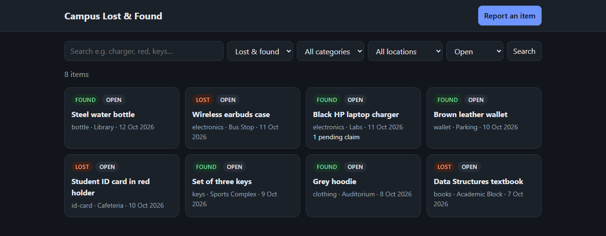
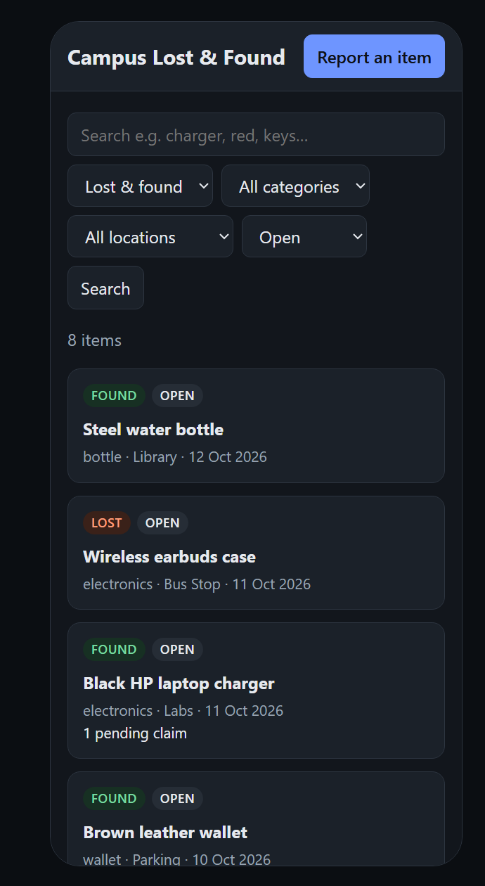
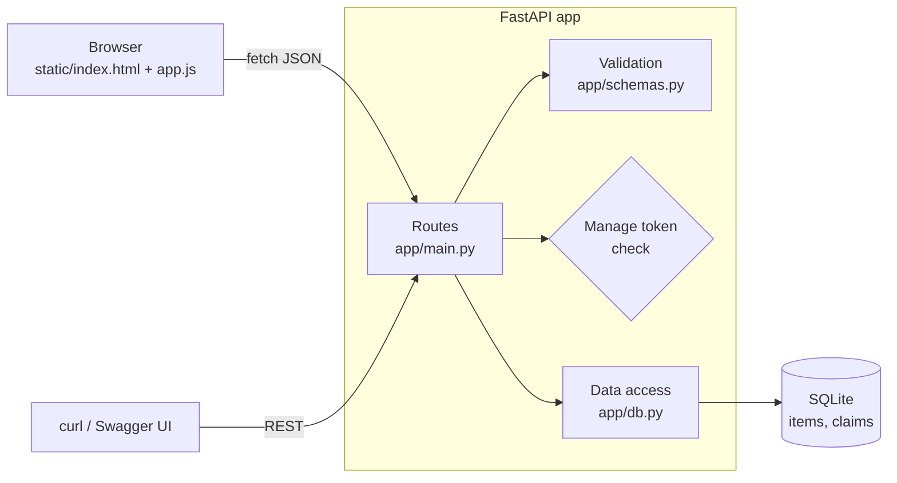

# Campus Lost & Found

[](https://github.com/iwan-adler/campus-lost-and-found/actions/workflows/tests.yml)

A small web app where students report lost or found belongings, search the listings, and claim items. The finder verifies each claim before anything is handed over.

## Why

On most campuses, lost items end up in scattered WhatsApp groups or at a security desk nobody checks. Messages get buried, and there's no way to search for "black charger near the labs". This app gives each item one searchable listing. It also has a claim step, so a finder can ask for proof before handing anything over.

**Who would use it:** students and staff who lose or find things on campus. The design keeps contact details private: they're never shown publicly.

## Screenshots

Captured from the running app with the bundled sample data (`python -m app.seed`). The page follows the system light/dark setting; these are in dark mode.

<table>
  <tr>
    <td width="68%"></td>
    <td></td>
  </tr>
  <tr>
    <td align="center">Desktop: search, filters and listings</td>
    <td align="center">Phone width (390&nbsp;px)</td>
  </tr>
</table>

## Features (implemented and tested)

- **Report** a lost or found item with title, description, category, location and date. Input is validated: fixed categories and locations, no future dates, length limits.
- **Search** by keywords (every word must match the title or description), with filters for lost/found, category, location and status. Results are paginated, newest first.
- **Item details** in a dialog.
- **Claims** on found items: the claimant gives their name, contact and proof of ownership.
- **Owner tools**, protected by the listing's manage token:
  - view claims, including the claimant's contact details
  - approve or reject a claim (approving one rejects the other pending claims and marks the item `claimed`)
  - change status `open → claimed → returned` (invalid moves are refused)
- **Web UI** in plain HTML, CSS and JavaScript, with light/dark mode, keyboard access and phone-width layout.
- **Sample data** with 8 listings and one pending claim.
- **Interactive API docs** at `/docs`.

## How access control works (without user accounts)

Building a full login system was out of scope, so the app uses **per-listing secret tokens**, the same idea as an "edit link" in many apps:

1. When you report an item, the server generates a random token (`secrets.token_urlsafe`) and returns it **once**.
2. The database stores only its **SHA-256 hash**, so a leaked database file doesn't reveal working tokens.
3. Managing the listing (status changes, viewing claims) needs the token in the `X-Manage-Token` header. A missing token returns `401`, a wrong one `403`. The comparison uses `hmac.compare_digest`, which takes the same time either way, so an attacker can't learn anything from timing.
4. The browser saves your tokens in `localStorage`, so you can manage your own listings without retyping. That's only a convenience; the server checks every request.

A claimant's contact details are returned only to the token holder. Public listing responses never include them.

## Architecture



| File | Responsibility |
|---|---|
| `app/main.py` | API routes, the token-check dependency, status-transition rules, serves the UI |
| `app/schemas.py` | Pydantic models: what the API accepts and what each audience gets back |
| `app/db.py` | All SQL: schema, search query, claim approval as a single transaction |
| `app/constants.py` | Categories, locations, allowed status transitions |
| `app/seed.py` | Loads sample data |
| `static/` | Web UI |

### Design decisions

- **One FastAPI app serves both API and UI.** `/api/*` is JSON, and `/` serves the static files. There's no build step, no CORS setup and only one process to run.
- **Plain `sqlite3`, no ORM.** Two tables and readable SQL. `LIKE` wildcards in search input (`%`, `_`) are escaped, so a search for `%` doesn't match everything, and all values are passed as `?` parameters, which prevents SQL injection.
- **Approving a claim is atomic.** Approving one claim, rejecting the others and updating the item happen in one database transaction, so the data can't end up half-updated.
- **Different response models for different readers.** `ClaimReceipt` (what the claimant gets back) has no contact fields, and `ClaimOut` (what the token holder sees) does. FastAPI's `response_model` filters out anything not in the model, so the hash or a contact can't leak by accident.
- **No `innerHTML` with user data.** The UI builds elements with `textContent`, so a listing titled `` shows as text and doesn't run. This was tested in the browser.

## Setup

Requires Python 3.12+ (developed on Python 3.14).

```bash
git clone https://github.com/iwan-adler/campus-lost-and-found.git
cd campus-lost-and-found
python -m venv .venv
```
```powershell
.venv\Scripts\Activate.ps1          # Windows PowerShell
```
```bash
source .venv/bin/activate           # macOS / Linux
```
```bash
pip install -r requirements.txt
python -m app.seed                  # optional: load 8 sample listings
uvicorn app.main:app --reload
```

- Web app: http://127.0.0.1:8000
- API docs: http://127.0.0.1:8000/docs

| Variable | Default | Meaning |
|---|---|---|
| `LOST_FOUND_DB` | `lost_and_found.db` | SQLite file path |

### Try the owner workflow with sample data

Sample listings have **public demo tokens** (`demo-token-1` … `demo-token-8`, listed in [`examples/sample_items.json`](examples/sample_items.json)). Open **Black HP laptop charger**, expand "I reported this item", enter `demo-token-1`, and you'll see its pending claim with Approve/Reject buttons.

Because these tokens are public, never run `app.seed` against a database with real listings. It refuses to seed a non-empty database anyway.

## API examples

```bash
# Report a found item. Save the manage_token from the response.
curl -X POST http://127.0.0.1:8000/api/items -H "Content-Type: application/json" -d '{
  "kind": "found", "title": "Casio calculator", "description": "fx-991 found on a hostel bench",
  "category": "electronics", "location": "Hostel", "event_date": "2026-10-12"}'

# Search
curl "http://127.0.0.1:8000/api/items?q=calculator&kind=found&location=Hostel"

# Claim it
curl -X POST http://127.0.0.1:8000/api/items/1/claims -H "Content-Type: application/json" -d '{
  "claimant_name": "Test Student", "contact": "student@example.com",
  "details": "My name is scratched on the back cover"}'

# Finder reviews and approves (token required)
curl http://127.0.0.1:8000/api/items/1/claims -H "X-Manage-Token: <token>"
curl -X PATCH http://127.0.0.1:8000/api/items/1/claims/1 -H "X-Manage-Token: <token>" \
     -H "Content-Type: application/json" -d '{"decision": "approve"}'

# Mark as returned
curl -X PATCH http://127.0.0.1:8000/api/items/1/status -H "X-Manage-Token: <token>" \
     -H "Content-Type: application/json" -d '{"status": "returned"}'
```

| Method | Path | Auth | Description |
|---|---|---|---|
| `GET` | `/api/options` | | Valid categories and locations |
| `POST` | `/api/items` | | Report an item (`201`, returns token once) |
| `GET` | `/api/items` | | Search: `q`, `kind`, `category`, `location`, `status`, `limit` (1–100), `offset` |
| `GET` | `/api/items/{id}` | | Item details |
| `PATCH` | `/api/items/{id}/status` | token | Change status (`409` on invalid transition) |
| `POST` | `/api/items/{id}/claims` | | Claim a found item (`400` for lost items, `409` if not open) |
| `GET` | `/api/items/{id}/claims` | token | List claims with contact details |
| `PATCH` | `/api/items/{id}/claims/{claim_id}` | token | `approve` / `reject` a pending claim |

## Run with Docker

```bash
docker compose up --build        # then open http://127.0.0.1:8000
```

How the image is set up:
- **Base:** `python:3.14-slim`, with runtime dependencies only (pytest stays out of the image).
- **Non-root user,** with the SQLite database on a named volume (`/data`), so data survives rebuilds and restarts.
- **Built-in `HEALTHCHECK`.**
- **Published on `127.0.0.1` only,** because the app has no login. Change the port mapping in `compose.yaml` only if you understand that exposes it to your network.

To load the sample listings, run `docker compose run --rm app python -m app.seed`.

**How this is verified:** the CI `docker` job checks every push on a real Docker engine. It:
1. builds the image;
2. waits for the container to report **healthy**;
3. checks it runs as a **non-root** user;
4. creates data through the API;
5. restarts the container and confirms the **data is still there**.

Docker isn't installed on the development machine, so CI is where the image is tested.

## Tests

```bash
python -m pytest
```

There are 50 tests, which run in a few seconds against a temporary database. They cover:

- the full workflow: report → two claims → approve one → the other is auto-rejected → no new claims → returned
- input validation and boundaries (bad enums, short or long text, future dates, missing fields, bad search parameters)
- authorization: no token, wrong token, another listing's token, a claim ID from a different item
- search: case-insensitive, multi-word, `%`/`_` treated literally, filter combinations, pagination
- status transitions, including that `returned` is final
- persistence across restarts, and seeding

To check that the security tests can actually fail, I disabled the token comparison: 3 authorization tests failed, then passed again once it was restored.

The UI has no automated tests. It was checked by hand in a browser: search, reporting, the claim flow, approve, status change, the error message for an invalid transition, and the XSS case above.

## Limitations

- **No real user accounts.** Whoever holds the token controls the listing, and a lost token can't be recovered.
- **No spam or rate limiting.** Anyone can post listings or claims.
- **Contact details are stored in plain text** in SQLite. A real deployment would need a privacy policy, data retention rules and HTTPS.
- Listings have no photos.
- Keyword search uses SQL `LIKE`. That's fine for hundreds of items, but it doesn't rank results, handle typos or match word stems.
- Categories and locations are fixed in `app/constants.py`.

## Next steps

1. Sign-in with university email (SSO) to replace per-listing tokens.
2. Photo uploads with size and type checks.
3. Email notification to the finder when a claim arrives.
4. SQLite FTS5 full-text search for ranked results.
5. Auto-expire listings after 60 days.
